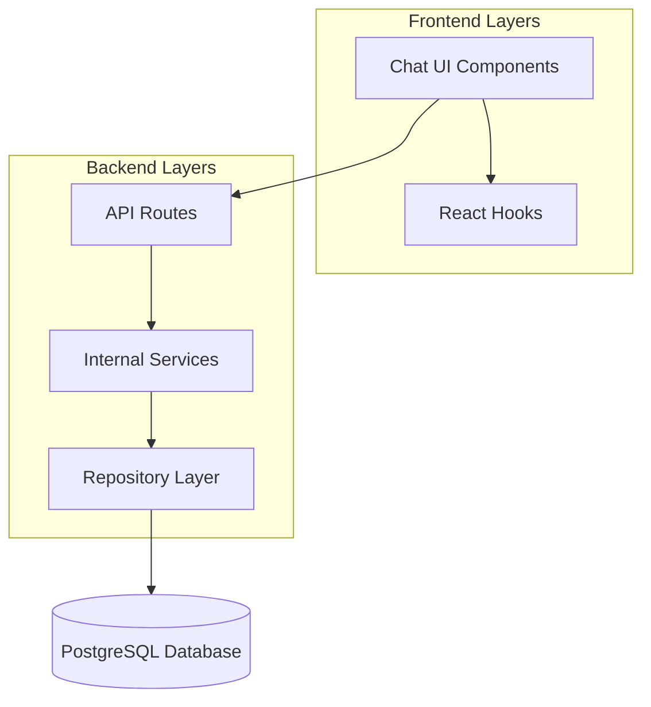
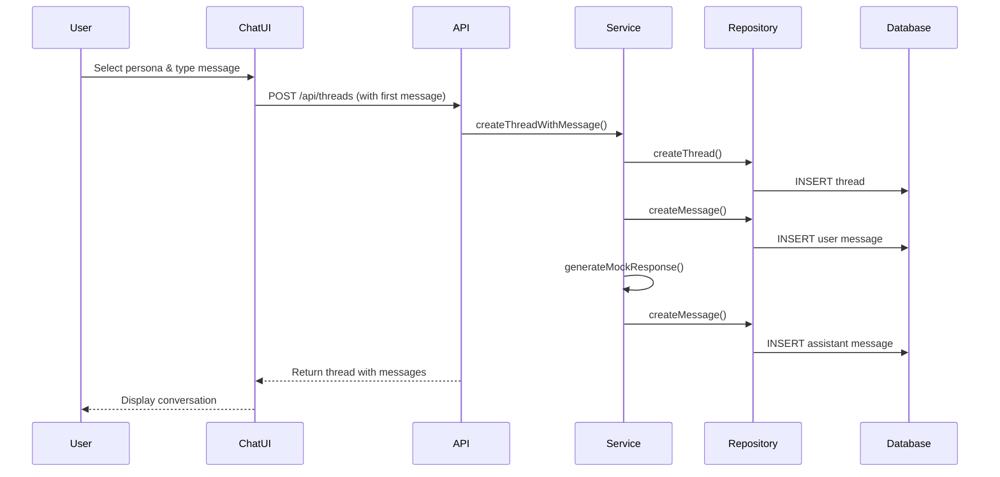

# Design Document

## Overview

The chat application feature extends the existing Next.js application with a persona-based conversation system. It leverages the existing database schema (Thread, Persona, Message models) and follows the established architectural patterns. The system implements lazy thread creation, mock response generation, and comprehensive conversation management.

## Architecture

### High-Level Architecture



### Data Flow



## Components and Interfaces

### Frontend Components (Atomic Design)

#### Atoms

- `MessageBubble`: Individual message display component
- `PersonaSelector`: Dropdown for selecting personas
- `ThreadListItem`: Single thread item in sidebar
- `SendButton`: Message send button with loading states

#### Molecules

- `MessageInput`: Input field with send button and persona selector
- `ConversationHeader`: Thread title and actions
- `PersonaCard`: Persona display with actions
- `ThreadSidebar`: List of threads with search/filter

#### Organisms

- `ChatInterface`: Main chat layout with sidebar and conversation
- `PersonaManager`: Full persona management interface
- `ConversationView`: Message history and input area

### API Endpoints

```typescript
// Thread Management
POST / api / threads; // Create thread with first message
GET / api / threads; // Get user's threads
GET / api / threads / [id]; // Get thread with messages
DELETE / api / threads / [id]; // Delete thread
POST / api / threads / [id] / messages; // Add message to thread

// Persona Management
GET / api / personas; // Get user's active personas
POST / api / personas; // Create new persona
PUT / api / personas / [id]; // Update persona
DELETE / api / personas / [id]; // Deactivate persona (soft delete)
```

### Service Layer Interfaces

```typescript
// services/internal/chat.ts
interface ChatService {
  createThreadWithMessage(
    userId: number,
    personaId: number,
    content: string
  ): Promise<ThreadWithMessages>;
  addMessageToThread(
    threadId: number,
    content: string,
    role: 'user' | 'assistant'
  ): Promise<Message>;
  generateMockResponse(persona: Persona, userMessage: string): Promise<string>;
  getThreadWithMessages(threadId: number): Promise<ThreadWithMessages>;
}

// services/internal/persona.ts
interface PersonaService {
  createPersona(userId: number, data: CreatePersonaData): Promise<Persona>;
  getUserPersonas(userId: number): Promise<Persona[]>;
  deactivatePersona(personaId: number): Promise<void>;
  updatePersona(personaId: number, data: UpdatePersonaData): Promise<Persona>;
}
```

### Repository Layer Interfaces

```typescript
// services/repositories/thread/index.ts
interface ThreadRepository {
  create(data: CreateThreadData): Promise<Thread>;
  findByUserId(userId: number): Promise<Thread[]>;
  findByIdWithMessages(threadId: number): Promise<ThreadWithMessages>;
  delete(threadId: number): Promise<void>;
}

// services/repositories/message/index.ts
interface MessageRepository {
  create(data: CreateMessageData): Promise<Message>;
  findByThreadId(threadId: number): Promise<Message[]>;
}

// services/repositories/persona/index.ts
interface PersonaRepository {
  create(data: CreatePersonaData): Promise<Persona>;
  findActiveByUserId(userId: number): Promise<Persona[]>;
  update(id: number, data: UpdatePersonaData): Promise<Persona>;
  softDelete(id: number): Promise<void>;
}
```

## Data Models

### Extended Type Definitions

```typescript
// types/chat.ts
interface ThreadWithMessages extends Thread {
  messages: Message[];
  persona: Persona | null;
}

interface CreateThreadData {
  userId: number;
  personaId: number;
  title: string;
}

interface CreateMessageData {
  threadId: number;
  role: 'user' | 'assistant';
  content: string;
}

interface CreatePersonaData {
  userId: number;
  name: string;
  description: string;
  instructions: string;
  tags: string[];
}

interface UpdatePersonaData {
  name?: string;
  description?: string;
  instructions?: string;
  tags?: string[];
}

// types/api.ts
interface CreateThreadRequest {
  personaId: number;
  message: string;
}

interface CreatePersonaRequest {
  name: string;
  description: string;
  instructions: string;
  tags: string[];
}

interface AddMessageRequest {
  content: string;
}
```

### Database Schema Usage

The design leverages existing Prisma models:

- `Thread`: Stores conversation metadata and persona association
- `Message`: Stores individual messages with role (user/assistant)
- `Persona`: Stores persona definitions with soft delete support
- `User`: Links all entities to authenticated users

## Error Handling

### API Error Responses

```typescript
interface ApiError {
  error: string;
  message: string;
  statusCode: number;
}

// Common error scenarios:
// 400: Invalid request data
// 401: Unauthorized access
// 404: Thread/Persona not found
// 403: Access denied to resource
// 500: Internal server error
```

### Frontend Error Handling

- Form validation errors displayed inline
- API errors shown as toast notifications
- Loading states during async operations
- Graceful degradation for network issues
- Retry mechanisms for failed requests

## Testing Strategy

### Unit Tests

- Repository layer: Database operations
- Service layer: Business logic and mock response generation
- API routes: Request/response handling
- Components: Rendering and user interactions

### Integration Tests

- End-to-end conversation flow
- Thread creation and message persistence
- Persona management workflows
- Navigation and routing

### Mock Response Strategy

```typescript
// services/internal/mockResponse.ts
interface MockResponseGenerator {
  generateResponse(persona: Persona, userMessage: string): string;
}

// Implementation approaches:
// 1. Template-based responses referencing persona instructions
// 2. Random selection from predefined response patterns
// 3. Simple acknowledgment with persona context
// 4. Configurable response delay (1-2 seconds)
```

## Navigation Integration

### Sidebar Updates

```typescript
// Updated navigation array in Sidebar.tsx
const navigation = [
  { name: 'Overview', href: '/app/overview', icon: RiHome2Line },
  { name: 'Chat', href: '/app/chat', icon: RiChatLine },
  { name: 'Personas', href: '/app/personas', icon: RiUserLine },
] as const;
```

### Route Structure

```
/app/chat                 // Main chat interface
/app/personas            // Persona management
/app/chat/[threadId]     // Specific thread (optional enhancement)
```

## Performance Considerations

### Optimization Strategies

- Lazy loading of thread messages
- Show Skeleten while loading
- User react queries in hooks to fetch data
- Pagination for large conversation histories
- Debounced search in thread sidebar
- Optimistic UI updates for message sending
- Efficient re-rendering with React.memo

### Caching Strategy

- Client-side caching of persona list
- Thread list caching with invalidation
- Message history caching per thread
- Optimistic updates for immediate feedback

## Security Considerations

### Authentication & Authorization

- All API routes protected with user authentication (check middleware for this)
- Users can only access their own threads and personas
- Soft delete for data retention and audit trails
- Input validation and sanitization

### Data Protection

- Message content sanitization
- Persona instruction validation
